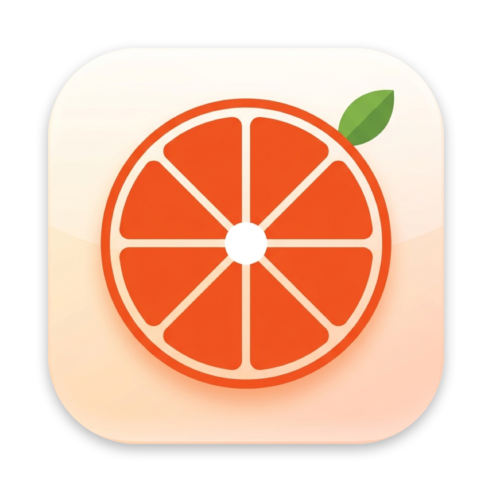

<p align="center">
  
</p>

<h1 align="center">OpenTangerine</h1>

<p align="center">
  Open-source macOS radial file converter &amp; image toolkit — triggered by <b>Shift + Drag</b> in Finder.
</p>

---

## ✨ Features

OpenTangerine lives in your menu bar. Start dragging any file in Finder, then hold a modifier key and a radial
"wheel" menu pops up under your cursor. Release over a slice to run the action — the result is saved next to the
original file and revealed in Finder.

| Gesture | Wheel | What you get |
|---|---|---|
| **⇧ Shift + Drag** | Convert | PDF → DOCX / JPG / PNG / TXT · Images → PNG / WEBP / HEIC / JPG / AVIF / BMP / PDF / DOCX / TIFF |
| **⌥⇧ Option + Shift + Drag** | Tools | Crop (aspect presets, pixel dimensions) · Add BG (backdrop, corners, shadow) · Metadata (EXIF/GPS inspector & clean export) · Compress |

Everything runs **100% offline** using Apple frameworks (PDFKit, ImageIO, CoreGraphics, SwiftUI).

### 🎨 Customizable Themes & Liquid Glass

Customize the look and feel from the menu bar or **Theme & Appearance Settings** (`⌘,`):
- **Tangerine Sunset**: The signature citrus orange with warm amber glow
- **Liquid Glass**: Translucent fluid glass with specular iridescent rim and a live **customizable transparency slider** (Crystal, Balanced, Frosted) that connects to macOS System Settings (*Accessibility → Display → Reduce Transparency*)
- **Cyber Cyan**: Electric neon cyan with cyber glow
- **Neon Violet**: Deep ultraviolet with magenta luminescence
- **Emerald Mint**: Fresh botanical mint & emerald green
- **Solar Gold**: Radiant amber with golden warmth
- **Monochrome**: Clean minimalist slate & frosted white

### ⚡ Performance, Memory & Stability (v1.0.3)

- **Ultra-Low Memory Footprint (~16 MB)**: Active heap pressure relief and cache pruning (`malloc_zone_pressure_relief`) automatically return decoded bitmap caches and unused heap pages to the macOS kernel whenever the radial wheel dismisses or editors close.
- **Crash-Free Window Architecture**: Fully isolated AppKit window management with zero use-after-free or dangling pointer hazards (`isReleasedWhenClosed = false`).
- **Optimized Theme Switching**: Smooth real-time reactive theme transitions across the radial wheel, MenuBarExtra, and modal editors without AppKit menu tracking interference.
- **Robust Metadata Engine**: Safe CoreGraphics image source validation and thumbnail dimensions checking.
- **Keyboard Shortcuts**: Press `Escape` in any editor or settings window to dismiss immediately.
- **Safe Batch Handling**: Multi-file drag protection ensures interactive tools launch cleanly for single inspection while batch converters process all selected files in parallel.

## 📦 Install

1. Download `OpenTangerine-<version>-macOS.zip` from the [Releases](https://github.com/Ayanatiach/OpenTangerine/releases) page
   (or build it yourself — see below).
2. Unzip and drag **OpenTangerine.app** into `/Applications`.
3. The app is ad-hoc signed (not notarized), so on first launch **right-click → Open**, then confirm.
   Alternatively: `xattr -dr com.apple.quarantine /Applications/OpenTangerine.app`
4. Grant permissions when prompted in **System Settings → Privacy & Security**:
   - **Accessibility** / **Input Monitoring** — needed to observe the Shift/Option keys and mouse while dragging in Finder.

OpenTangerine runs as a menu-bar-only app (no Dock icon). Look for the ⬢ icon in the menu bar.

## 🛠 Build from source

Requirements: macOS 13 Ventura or later, Xcode 15+ (Swift 5.9+).

```bash
git clone https://github.com/Ayanatiach/OpenTangerine.git
cd OpenTangerine

# Run directly
swift run -c release

# …or produce a signed, universal (arm64 + x86_64) .app bundle + zip in ./dist
./scripts/package_app.sh
# host-architecture-only build:
./scripts/package_app.sh --native
```

## 🗂 Project layout

```
OpenTangerine/
├── Package.swift                     # SwiftPM manifest (macOS 13+, executable target)
├── Sources/OpenTangerine/
│   └── OpenTangerine.swift           # App: drag monitor, radial wheel, conversion engine, editors
├── Assets/AppIcon.png                # 1024×1024 source icon (converted to .icns at package time)
└── scripts/package_app.sh            # Builds & bundles OpenTangerine.app
```

## 📄 License

[MIT](LICENSE) © 2026 Ayanatiach
